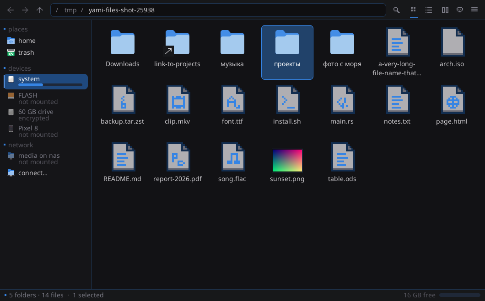
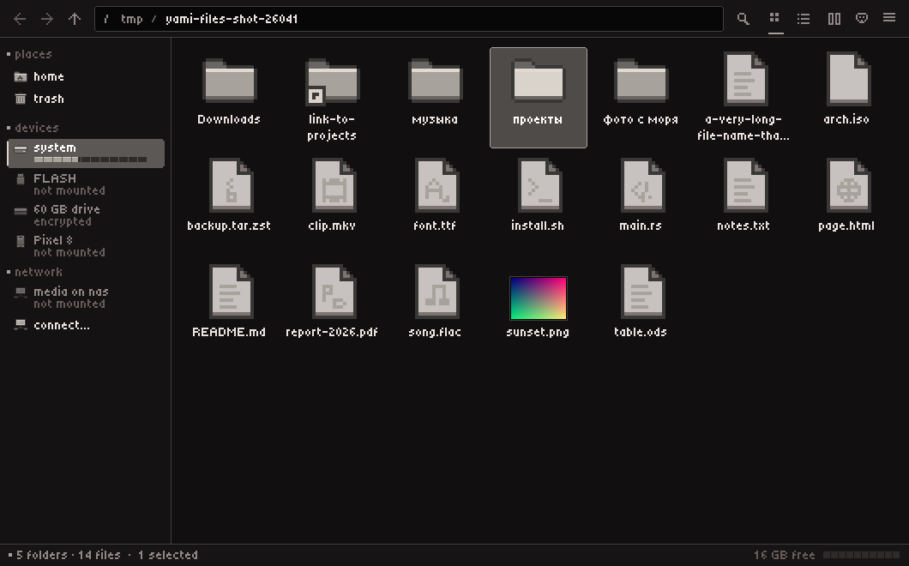

# nemo-files

English · [Русский](README.ru.md)

A file manager for Wayland that is also the file dialog of every app. Its own renderer, no toolkit:
one binary of a few megabytes, about ten megabytes of memory, open in a blink. Part of the
[Nemo](https://github.com/HamzaAkramv15/nemo) desktop, and works on its own on any Wayland compositor
(niri, Hyprland, Sway, river, KDE, GNOME): no nemo shell needed.

| neutral look (`plain`) | pixel look (`nemo`) |
|---|---|
|  |  |

## What it does

- Tabs and two panes side by side, a grid with thumbnails or a list, natural name order, undo.
- Copy, move and trash in the background with progress; archives through `bsdtar`.
- Drives, phones (MTP), cameras (PTP), iPhones, encrypted drives and network places (SMB, SFTP,
  FTP, WebDAV, NFS) in the sidebar; «connect to a server» remembers the address, never the password.
- The file dialog of browsers, Telegram and every GTK or Qt app through `xdg-desktop-portal`, and
  «show in folder» (`org.freedesktop.FileManager1`).
- Shortcuts by key position: Ctrl+C works in any keyboard layout.

## Install

**One file** (x86_64, glibc 2.34 or newer: every distribution of the last years):

```sh
curl -LO https://github.com/HamzaAkramv15/nemo/releases/latest/download/nemo-files
chmod +x nemo-files
./nemo-files install
```

No Rust and no root. `install` asks the language, the look (neutral or pixel) and three things
(open folders in it by default, the file dialog of every app, «show in folder» for every app), lists
what it will change and writes into `~/.local` only after your yes. `--yes` takes the defaults,
`--all` says yes to every question.

**From source** (Rust 1.89 or newer):

```sh
git clone https://github.com/HamzaAkramv15/nemo-files
cd nemo-files
cargo build --release --locked
target/release/nemo-files install
```

The drawing library, nemo-px, comes with the build from the [Nemo](https://github.com/HamzaAkramv15/nemo)
repository at the tag `Cargo.toml` names.

`nemo-files deps` lists what it uses from the system: wayland and libxkbcommon; optional
ffmpegthumbnailer (video thumbnails), libarchive (`bsdtar`, archives), udisks2 and gvfs (drives,
phones, network places). `nemo-files uninstall` takes everything back.

## Use

```sh
nemo-files [FOLDER…]              # a window, one tab per folder
nemo-files --pick open|save|dir   # a dialog for scripts: the chosen paths on stdout, one per line
nemo-files --props FILE…          # file properties
nemo-files shot -o DIR            # the window as PNG without Wayland (for themes and bug reports)
```

`--pick` also takes `--multiple`, `--title T`, `--name NAME`, `--folder DIR` and
`--filter "Images|*.png;*.jpg|image/*"`.

The file dialog of every app: once `install` registered it, add this line under `[preferred]` in
`~/.config/xdg-desktop-portal/portals.conf` (or `<desktop>-portals.conf`):

```ini
org.freedesktop.impl.portal.FileChooser=nemo;gtk;
```

| Keys | |
|---|---|
| Ctrl+T, Ctrl+W, Ctrl+Tab | new tab, close it, next tab |
| F3, Tab | two panes, the other pane |
| F2, Delete, Shift+Delete | rename, to the trash, delete |
| Ctrl+C, Ctrl+X, Ctrl+V, Ctrl+Z | copy, cut, paste, undo |
| Ctrl+Shift+N, Ctrl+N | new folder, new window |
| Ctrl+H, Ctrl+L, Ctrl+F | hidden files, type a path, filter |
| Ctrl+1, Ctrl+2, Ctrl+= and Ctrl+- | grid, list, bigger and smaller icons |
| F4, F5, F9, F11 | terminal here, reload, sidebar, details |
| Backspace, Alt+arrows | up, back and forward |
| Space | quick look: a picture opens in nemo-view (the arrows there page through the folder) |

## Settings

`~/.config/nemo/files.json`: the program writes it as you use it; edit it by hand if you like,
it is read at the next start.

| Key | Default | What |
|---|---|---|
| `view` | `grid` | `grid` or `list` |
| `zoom` | `2` | icon size in the grid, 0 to 4 |
| `hidden`, `foldersFirst` | `false`, `true` | show dot files, folders on top |
| `sort`, `desc` | `name`, `false` | `name`, `size`, `time` or `type`; reversed |
| `thumbs`, `thumbMaxMb` | `true`, `40` | thumbnails, and for pictures up to how many MB |
| `sidebar`, `devices`, `network` | `true` | the sidebar and its sections |
| `placesOrder`, `placesHidden`, `devsHidden` | `[]` | the order of places (drag them), hidden places and drives |
| `collapsed` | `[]` | folded sections: `places`, `devices`, `network` |
| `info` | `false` | the details pane |
| `terminal` | `kitty` | what F4 opens |
| `confirmTrash`, `singleClick`, `split` | `false` | ask before the trash, open with one click, start with two panes |

## Look and themes

Without any configuration it takes a neutral look: the system font, rounded corners, soft shadows,
light or dark as your system is set. Every part of it can be changed in two files, and the window
restyles itself the moment you save them:

| File | What |
|---|---|
| `~/.config/nemo/style.json` | the look of every nemo program: write a theme once, all of them take it |
| `~/.config/nemo/style.files.json` | what nemo-files does differently (only those keys) |

| Key | Values |
|---|---|
| `preset` | `plain` (neutral) or `nemo` (pixel art: whole pixels, notched corners, the Tiny5 font inside the binary) |
| `palette`, `accent` | `blood`, `ash`, `sakura`, `amber`, `venom`, `ice`, `dusk`; or any `#rrggbb`: the rest of the palette is made from it |
| `light` | `true` or `false`; absent: as the system |
| `corners`, `radius` | `notch`, `round` or `square`; the radius in pixels |
| `shadow`, `bevel` | `hard`, `soft` or `none`; a raised edge on buttons |
| `reveal` | how panels appear: `fade`, `none`, `dither`, `scan`, `noise`, `wipe`, `blocks` |
| `font`, `fontFiles` | a font family for every program, or for this one |
| `animations`, `animSpeed` | on or off; their length (0.5 fast, 2 slow) |
| `iconTheme`, `iconPixel`, `iconTint` | an icon set; icons redrawn as pixel art; in the palette's tones |
| `colors` | any of `bg panel surface surfaceHi codeBg border dim accent deep glow bright selection text textDim textFaint onAccent textHi ok warn` |
| `lang` | `ru`, `en`, `pt-BR`, `es`, `de`, `fr`, `uk`, `pl`; empty: as the system |

A theme of your own, for example a cold dark one:

```json
{
  "preset": "plain",
  "accent": "#88c0d0",
  "light": false,
  "corners": "round",
  "radius": 10,
  "font": "Inter",
  "colors": { "bg": "#2e3440", "panel": "#2e3440", "surface": "#3b4252", "text": "#eceff4" }
}
```

…or the pixel look in any colour: `{ "preset": "nemo", "accent": "#d65d0e" }`. Inside the nemo
desktop the shell writes `style.json` itself (settings → look); `style.files.json` still wins.

## License

MIT
