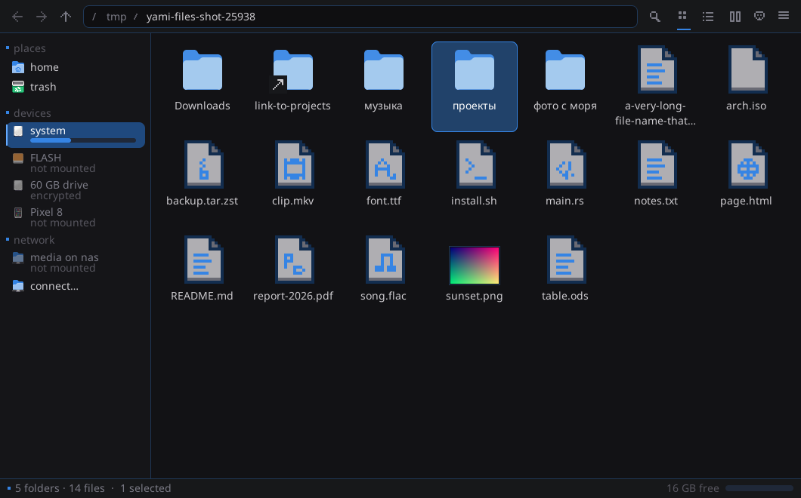
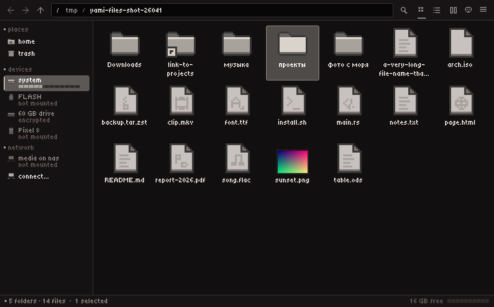

# yami-files

[English](README.md) · Русский

Файловый менеджер для Wayland, который заодно диалог выбора файлов для всех программ. Свой рендер,
без тулкитов: один бинарь в несколько мегабайт, около десятка мегабайт памяти, открывается мгновенно. Часть рабочего
стола [yami](https://github.com/Trendorin/yami), которая работает и сама по себе в любом
Wayland-композиторе (niri, Hyprland, Sway, river, KDE, GNOME): шелл yami не нужен.

| нейтральный вид (`plain`) | пиксельный вид (`yami`) |
|---|---|
|  |  |

## Что умеет

- Вкладки и две панели рядом, сетка с миниатюрами или список, естественный порядок имён, отмена.
- Копирование, перенос и корзина в фоне с прогрессом; архивы через `bsdtar`.
- Диски, телефоны (MTP), камеры (PTP), iPhone, зашифрованные диски и сеть (SMB, SFTP, FTP, WebDAV,
  NFS) в боковой панели; «подключиться к серверу» помнит адрес, но не пароль.
- Диалог выбора файлов для браузеров, Telegram и всех программ на GTK и Qt через
  `xdg-desktop-portal`, и «показать в папке» (`org.freedesktop.FileManager1`).
- Сочетания клавиш по положению клавиши: Ctrl+C работает в любой раскладке.

## Установка

**Один файл** (x86_64, glibc 2.34 или новее: любой дистрибутив последних лет):

```sh
curl -LO https://github.com/Trendorin/yami/releases/latest/download/yami-files
chmod +x yami-files
./yami-files install
```

Без Rust и root. `install` спросит язык, вид (нейтральный или пиксельный) и три вещи (открывать
папки в нём по умолчанию, диалог выбора файлов для всех программ, «показать в папке» для всех
программ), покажет, что изменит, и запишет в `~/.local` только после твоего «да». `--yes` берёт
ответы по умолчанию, `--all` отвечает «да» на всё.

**Из исходников** (Rust 1.89 или новее):

```sh
git clone https://github.com/Trendorin/yami-files
cd yami-files
cargo build --release --locked
target/release/yami-files install
```

Библиотека рисования yami-px приходит при сборке из репозитория
[yami](https://github.com/Trendorin/yami) по тегу, который назван в `Cargo.toml`.

`yami-files deps` — что берётся из системы: wayland и libxkbcommon; по желанию ffmpegthumbnailer
(миниатюры видео), libarchive (`bsdtar`, архивы), udisks2 и gvfs (диски, телефоны, сеть).
`yami-files uninstall` убирает всё обратно.

## Как пользоваться

```sh
yami-files [ПАПКА…]               # окно, по вкладке на папку
yami-files --pick open|save|dir   # диалог для скриптов: выбранные пути в stdout, по строке
yami-files --props ФАЙЛ…          # свойства файлов
yami-files shot -o ПАПКА          # окно в PNG без Wayland (для тем и сообщений об ошибках)
```

`--pick` принимает ещё `--multiple`, `--title T`, `--name ИМЯ`, `--folder ПАПКА` и
`--filter "Картинки|*.png;*.jpg|image/*"`.

Диалог выбора файлов для всех программ: когда `install` его зарегистрировал, добавь строку в раздел
`[preferred]` файла `~/.config/xdg-desktop-portal/portals.conf` (или `<рабочий стол>-portals.conf`):

```ini
org.freedesktop.impl.portal.FileChooser=yami;gtk;
```

| Клавиши | |
|---|---|
| Ctrl+T, Ctrl+W, Ctrl+Tab | новая вкладка, закрыть её, следующая |
| F3, Tab | две панели, другая панель |
| F2, Delete, Shift+Delete | переименовать, в корзину, удалить |
| Ctrl+C, Ctrl+X, Ctrl+V, Ctrl+Z | копировать, вырезать, вставить, отменить |
| Ctrl+Shift+N, Ctrl+N | новая папка, новое окно |
| Ctrl+H, Ctrl+L, Ctrl+F | скрытые файлы, ввести путь, фильтр |
| Ctrl+1, Ctrl+2, Ctrl+= и Ctrl+- | сетка, список, значки крупнее и мельче |
| F4, F5, F9, F11 | терминал здесь, обновить, боковая панель, сведения |
| Backspace, Alt+стрелки | наверх, назад и вперёд |

## Настройки

`~/.config/yami/files.json`: программа пишет его сама по ходу дела; можно править руками, он
читается при следующем запуске.

| Ключ | По умолчанию | Что |
|---|---|---|
| `view` | `grid` | `grid` (сетка) или `list` (список) |
| `zoom` | `2` | размер значков в сетке, от 0 до 4 |
| `hidden`, `foldersFirst` | `false`, `true` | показывать файлы с точкой, папки сверху |
| `sort`, `desc` | `name`, `false` | `name`, `size`, `time` или `type`; в обратном порядке |
| `thumbs`, `thumbMaxMb` | `true`, `40` | миниатюры, и для картинок до скольких МБ |
| `sidebar`, `devices`, `network` | `true` | боковая панель и её разделы |
| `placesOrder`, `placesHidden`, `devsHidden` | `[]` | порядок мест (перетаскиваются), скрытые места и диски |
| `collapsed` | `[]` | свёрнутые разделы: `places`, `devices`, `network` |
| `info` | `false` | панель сведений |
| `terminal` | `kitty` | что открывает F4 |
| `confirmTrash`, `singleClick`, `split` | `false` | спрашивать перед корзиной, открывать одним щелчком, начинать с двух панелей |

## Вид и темы

Без настроек программа выглядит нейтрально: системный шрифт, скруглённые углы, мягкие тени,
светлая или тёмная тема как в системе. Любую часть меняют два файла, и окно перекрашивается в тот
же миг, как ты их сохранишь:

| Файл | Что |
|---|---|
| `~/.config/yami/style.json` | вид всех программ yami: тема пишется один раз, все её берут |
| `~/.config/yami/style.files.json` | чем yami-files отличается (только эти ключи) |

| Ключ | Значения |
|---|---|
| `preset` | `plain` (нейтральный) или `yami` (пиксель-арт: целые пиксели, углы с вырезом, шрифт Tiny5 внутри бинаря) |
| `palette`, `accent` | `blood`, `ash`, `sakura`, `amber`, `venom`, `ice`, `dusk`; или любой `#rrggbb`: остальная палитра строится от него |
| `light` | `true` или `false`; нет ключа — как в системе |
| `corners`, `radius` | `notch`, `round` или `square`; радиус в пикселях |
| `shadow`, `bevel` | `hard`, `soft` или `none`; выпуклый край у кнопок |
| `reveal` | как появляются панели: `fade`, `none`, `dither`, `scan`, `noise`, `wipe`, `blocks` |
| `font`, `fontFiles` | семейство шрифта для всех программ или только для этой |
| `animations`, `animSpeed` | вкл/выкл; их длительность (0.5 быстро, 2 медленно) |
| `iconTheme`, `iconPixel`, `iconTint` | набор значков; значки, перерисованные пиксель-артом; в тонах палитры |
| `colors` | любой из `bg panel surface surfaceHi codeBg border dim accent deep glow bright selection text textDim textFaint onAccent textHi ok warn` |
| `lang` | `ru`, `en`, `pt-BR`; пусто — как в системе |

Своя тема, например холодная тёмная:

```json
{
  "preset": "plain",
  "accent": "#88c0d0",
  "light": false,
  "corners": "round",
  "radius": 10,
  "font": "Inter",
  "colors": { "bg": "#2e3440", "panel": "#2e3440", "surface": "#3b4252", "text": "#eceff4" }
}
```

…или пиксельный вид любого цвета: `{ "preset": "yami", "accent": "#d65d0e" }`. В рабочем столе
yami `style.json` пишет сам шелл (настройки → вид); `style.files.json` всё равно главнее.

## Лицензия

MIT
